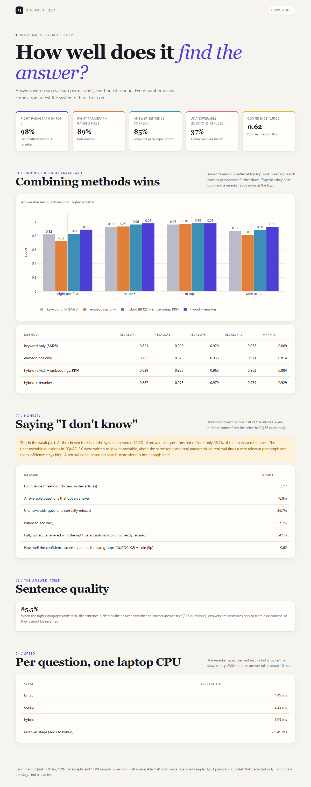

# Document Q&A: answers with sources, team permissions, and honest scoring

Ask questions about a collection of documents and get back a sentence copied from the right document, with the source shown. It combines keyword search and meaning-based search, respects who is allowed to see what, and is scored on a public benchmark so the quality is a measured number.



Open `outputs/report.html` for the full interactive report.

## The most useful lesson: what the numbers say

I tested on SQuAD 2.0, a public benchmark of Wikipedia paragraphs (1,204 here) with questions written by people. Half of the questions have an answer in the paragraph. The other half were written to look answerable but are not, which is the hard test for "say I don't know". The refusal threshold was tuned on one half of the articles and every number below comes from the other half.

**Finding the right paragraph works well, and combining methods helps.** On 240 answerable test questions:

| Method | Right paragraph first | In top 5 | MRR |
|---|---|---|---|
| Keyword search (BM25) | 82.1% | 92.9% | 0.869 |
| Meaning search (embeddings) | 72.5% | 93.3% | 0.814 |
| Both combined (rank fusion) | 82.9% | 96.3% | 0.884 |
| Both combined + reranker | **88.8%** | **97.9%** | **0.930** |

Neither method wins alone: keyword search is better at the top spot, meaning search catches paraphrases further down. Combining them beats both, and a reranker that reads the question and each candidate together adds another 6 points at the top spot.

When the right paragraph ranks first, the sentence picked as the answer contains the correct answer text 85.5% of the time.

**Saying "I don't know" works poorly, and I would rather show that than hide it.** At the chosen threshold the system answered 79% of answerable questions but only refused 37% of the unanswerable ones. The confidence score separates the two groups only weakly (AUROC 0.62, where 0.5 is a coin flip). This is a hard test on purpose: the unanswerable questions are about the same topic as a real paragraph, so the retrieval step finds a very relevant paragraph and the confidence stays high. A refusal signal based on search score alone is not enough here. A better one would need to check whether the specific answer is actually supported, for example by a model trained for that. I did not build that.

## What else it does

- **Permissions.** Each document belongs to a team (engineering, finance or HR). A user only searches documents their teams can see. The filter is applied before ranking, so documents a user cannot see never enter the candidate list and cannot leak through scores or citations. A property test with random users and questions checks this for all three search methods, and an API test checks it end to end.
- **Citations.** Every answer includes the title, team and a snippet of the source paragraph.
- **Optional language model.** `generate()` can ask any model to write a fluent answer from the allowed paragraphs only. A test proves the prompt never contains text from a team the user cannot read. I did not evaluate the model's answers, so no quality claim is made for that part. The default answer is an extracted sentence, which cannot be invented.
- **Small web page and API.** `uvicorn docqa.api:app --port 8001`, then open http://localhost:8001. Pick a user (alice sees engineering, bob finance, carol HR, admin everything).

The team assignment is arbitrary (SQuAD has no real permissions). It exists so the permission logic can be tested properly.

## How it works

```
question -> permission filter -> keyword search + meaning search -> rank fusion -> reranker -> best sentence + sources
                                                                                       |
                                          confidence below threshold? -> "I don't know" with the closest source
```

- `docqa/search.py`: BM25 keyword search, embeddings (`bge-small-en-v1.5` via fastembed, no GPU needed), reciprocal rank fusion, cross-encoder reranker.
- `docqa/qa.py`: the pipeline, sentence selection, the refusal rule and the optional language model prompt.
- `docqa/corpus.py`: loads the data and does the dev/test split by article.
- `evaluate.py`: scores everything. `report.py`: builds the report.

## Run it

```bash
pip install -r requirements.txt
# download the benchmark file once (4 MB):
#   https://rajpurkar.github.io/SQuAD-explorer/dataset/dev-v2.0.json  ->  data/dev-v2.0.json
python evaluate.py          # about 15 minutes on a laptop CPU (the reranker is the slow part)
python report.py
python -m pytest tests -q   # 14 tests
```

## Speed (one laptop CPU, average per question)

BM25 4.5 ms, embeddings 2.4 ms, both combined 7.1 ms, the reranker adds about 655 ms. The reranker gives the best results but is by far the slowest step. Without it, an answer takes about 10 ms.

## Limits

- 1,000 sampled questions (466 in the test half, 240 of them answerable), so small differences between methods are within noise. The gap between 82% and 89% at the top spot is larger than that, but I would not read anything into 0.5-point differences.
- The collection is 1,204 paragraphs. Behaviour on millions of documents is untested.
- English Wikipedia text only.
- Refusing to answer is weak, as described above.

Harshit Bihani
